<picture>
  <source media="(prefers-color-scheme: dark)" srcset="./assets/header-pt-dark.svg">
  
</picture>

   

<b>Português</b> · <a href="#english">English</a>

## 👋 Sobre mim

Sou desenvolvedor front-end com **mais de 6 anos de experiência**, a maior parte no setor financeiro, em projetos para **Banco do Brasil, Bradesco e Banco Safra**. Hoje sou referência técnica em diversos sistemas no Safra, conduzindo o time com code review, documentação e apoio a desenvolvedores júnior, pleno e sênior.

- ⚡ Domino **Angular**, do AngularJS às versões modernas (standalone components e signals)
- ⚛️ Uso **React** e **Next.js** nos meus projetos, sempre com **TypeScript**
- 🚀 Já reduzi o carregamento de páginas de **10 s para 600 ms**
- ♿ Me preocupo com arquitetura, testes automatizados e acessibilidade
- 🌐 Todos os projetos abaixo são bilíngues (pt-BR e en), testados e com demo no ar

<table>
<tr>
<td align="center" width="33%"><h3>6+</h3>anos de experiência</td>
<td align="center" width="33%"><h3>3</h3>grandes bancos atendidos</td>
<td align="center" width="33%"><h3>10 s → 0,6 s</h3>carregamento otimizado</td>
</tr>
</table>

## 🧰 Stack

  

  <code>RxJS</code> <code>NgRx</code> <code>Signals</code> <code>Angular Material</code> <code>Zustand</code> <code>TanStack Query</code> <code>React Hook Form</code> <code>Zod</code> <code>Socket.io</code> <code>Transloco</code> <code>i18next</code> <code>Karma</code> <code>Jasmine</code>

## 🚀 Projetos em destaque

Todos publicados em **[portfolio.brunoisaac.dev](https://portfolio.brunoisaac.dev/)**. Clique na imagem para abrir a demo.

<table>
<tr>
<td width="50%" valign="top">

<h4>Painel Admin de E-commerce</h4>
<code>Angular 20 · Material · Signals</code> 
Tabelas com paginação, ordenação e filtros, interceptors HTTP e guards por perfil. 
<a href="https://portfolio.brunoisaac.dev/angular-ecommerce-admin/"><b>Demo</b></a> · <a href="https://github.com/BrunoICosta/angular-ecommerce-admin">Código</a>
</td>
<td width="50%" valign="top">

<h4>Loja Virtual com Next.js</h4>
<code>Next.js 16 · React 19 · Zustand</code> 
App Router com páginas estáticas, carrinho persistente e checkout completo, bilíngue e com SEO. 
<a href="https://portfolio.brunoisaac.dev/next-ecommerce-store/"><b>Demo</b></a> · <a href="https://github.com/BrunoICosta/next-ecommerce-store">Código</a>
</td>
</tr>
<tr>
<td width="50%" valign="top">

<h4>Quadro Kanban</h4>
<code>Angular 20 · NgRx · CDK</code> 
Arrastar e soltar com atualização otimista e rollback, estado com Store, Effects e Entity. 
<a href="https://portfolio.brunoisaac.dev/angular-kanban-board/"><b>Demo</b></a> · <a href="https://github.com/BrunoICosta/angular-kanban-board">Código</a>
</td>
<td width="50%" valign="top">

<h4>Chat em Tempo Real</h4>
<code>React 19 · Socket.io · Node</code> 
Monorepo com contratos tipados, JWT, presença e modo demo que roda direto no navegador. 
<a href="https://portfolio.brunoisaac.dev/react-realtime-chat/"><b>Demo</b></a> · <a href="https://github.com/BrunoICosta/react-realtime-chat">Código</a>
</td>
</tr>
</table>

<b>📂 Ver os outros 7 projetos</b>

 

<table>
<tr>
<td width="50%" valign="top">

<h4>Explorador de Séries</h4>
<code>Angular 20 · RxJS · Signals</code> 
Busca com debounce, rolagem infinita, detalhes, elenco e agenda do dia. 
<a href="https://portfolio.brunoisaac.dev/angular-tv-explorer/"><b>Demo</b></a> · <a href="https://github.com/BrunoICosta/angular-tv-explorer">Código</a>
</td>
<td width="50%" valign="top">

<h4>Controle Financeiro</h4>
<code>Angular 20 · Material · Chart.js</code> 
Lançamentos, orçamento mensal, gráficos e máscara de valores por idioma. 
<a href="https://portfolio.brunoisaac.dev/angular-finance-tracker/"><b>Demo</b></a> · <a href="https://github.com/BrunoICosta/angular-finance-tracker">Código</a>
</td>
</tr>
<tr>
<td width="50%" valign="top">

<h4>Agenda de Atendimentos</h4>
<code>Angular 20 · FullCalendar · Transloco</code> 
Calendário com validadores customizados e visão adaptada ao celular. 
<a href="https://portfolio.brunoisaac.dev/angular-appointment-scheduler/"><b>Demo</b></a> · <a href="https://github.com/BrunoICosta/angular-appointment-scheduler">Código</a>
</td>
<td width="50%" valign="top">

<h4>Receitário</h4>
<code>React 19 · React Hook Form · Zod</code> 
Receitas do TheMealDB com tradução automática e receitas próprias validadas. 
<a href="https://portfolio.brunoisaac.dev/react-recipe-finder/"><b>Demo</b></a> · <a href="https://github.com/BrunoICosta/react-recipe-finder">Código</a>
</td>
</tr>
<tr>
<td width="50%" valign="top">

<h4>Painel do Clima</h4>
<code>React 19 · TanStack Query · Recharts</code> 
Busca de cidades, previsão horária e semanal e geolocalização. 
<a href="https://portfolio.brunoisaac.dev/react-weather-dashboard/"><b>Demo</b></a> · <a href="https://github.com/BrunoICosta/react-weather-dashboard">Código</a>
</td>
<td width="50%" valign="top">

<h4>Rastreador de Hábitos</h4>
<code>React 19 · PWA · Motion</code> 
Funciona offline, com sequências, mapa de calor anual e animações. 
<a href="https://portfolio.brunoisaac.dev/react-habit-tracker/"><b>Demo</b></a> · <a href="https://github.com/BrunoICosta/react-habit-tracker">Código</a>
</td>
</tr>
<tr>
<td width="50%" valign="top">

<h4>Espaço de Notas</h4>
<code>React 19 · dnd-kit · Zustand</code> 
Páginas aninhadas, blocos reordenáveis e menu de comandos com "/". 
<a href="https://portfolio.brunoisaac.dev/react-notes-workspace/"><b>Demo</b></a> · <a href="https://github.com/BrunoICosta/react-notes-workspace">Código</a>
</td>
<td width="50%"></td>
</tr>
</table>

## 💼 Por onde passei

<b>Analista de Sistemas · ACT Digital</b> · cliente Banco Safra · jul. 2021 até o momento

- Referência técnica em sistemas internos de maquininhas de cartão e domicílio bancário
- Aplicações em Angular e TypeScript, com testes em Jest e Karma
- Code review, documentação técnica e mentoria em times com Scrum e Kanban

<b>Analista de Sistemas · Everis / NTT DATA</b> · cliente Bradesco · abr. 2021 a jul. 2021

- Funcionalidades do módulo de Open Finance do aplicativo Bradesco com Angular

<b>Analista de Sistemas · Capgemini</b> · cliente Banco do Brasil · mar. 2020 a abr. 2021

- Migração de aplicações de AngularJS para Angular na plataforma interna do Banco do Brasil

<b>Estágios em TI · Banco do Brasil e SEPLAG / CODHAB</b> · ago. 2018 a mar. 2020

- PostgreSQL, Java, AngularJS e VueJS, documentação técnica e intranet

🎓 Bacharelado em Sistemas de Informação (Faculdade Projeção) · 📜 Scrum Foundation (SFPC) · Kanban Foundation (KIKF)

## 🐍 Atividade

<picture>
  <source media="(prefers-color-scheme: dark)" srcset="https://raw.githubusercontent.com/BrunoICosta/BrunoICosta/output/github-snake-dark.svg">
  
</picture>

---

<h2 id="english">🌎 English</h2>

<b>Open the English version</b>

 

<picture>
  <source media="(prefers-color-scheme: dark)" srcset="./assets/header-en-dark.svg">
  
</picture>

   

### 👋 About me

Front-end developer with **6+ years of experience**, mostly in the financial sector, on projects for **Banco do Brasil, Bradesco and Banco Safra**. Today I am the technical reference for several systems at Safra, leading the team through code review, documentation and mentoring.

- ⚡ Deep **Angular** expertise, from AngularJS to modern versions (standalone components and signals)
- ⚛️ I use **React** and **Next.js** in my own projects, always with **TypeScript**
- 🚀 Cut page load time from **10 s to 600 ms**
- ♿ I care about architecture, automated tests and accessibility
- 🌐 Every project below is bilingual (pt-BR and en), tested and live

### 🚀 Featured projects

All live at **[portfolio.brunoisaac.dev](https://portfolio.brunoisaac.dev/)**.

<table>
<tr>
<td width="50%" valign="top">

<h4>E-commerce Admin</h4>
<code>Angular 20 · Material · Signals</code> 
Material tables with pagination, sorting and filters, HTTP interceptors and role-based guards. 
<a href="https://portfolio.brunoisaac.dev/angular-ecommerce-admin/"><b>Demo</b></a> · <a href="https://github.com/BrunoICosta/angular-ecommerce-admin">Code</a>
</td>
<td width="50%" valign="top">

<h4>Next.js E-commerce Store</h4>
<code>Next.js 16 · React 19 · Zustand</code> 
App Router with static pages, persistent cart and full checkout, bilingual with SEO. 
<a href="https://portfolio.brunoisaac.dev/next-ecommerce-store/"><b>Demo</b></a> · <a href="https://github.com/BrunoICosta/next-ecommerce-store">Code</a>
</td>
</tr>
<tr>
<td width="50%" valign="top">

<h4>Kanban Board</h4>
<code>Angular 20 · NgRx · CDK</code> 
Drag and drop with optimistic updates and rollback, state with Store, Effects and Entity. 
<a href="https://portfolio.brunoisaac.dev/angular-kanban-board/"><b>Demo</b></a> · <a href="https://github.com/BrunoICosta/angular-kanban-board">Code</a>
</td>
<td width="50%" valign="top">

<h4>Realtime Chat</h4>
<code>React 19 · Socket.io · Node</code> 
Monorepo with typed contracts, JWT, presence and a demo mode that runs in the browser. 
<a href="https://portfolio.brunoisaac.dev/react-realtime-chat/"><b>Demo</b></a> · <a href="https://github.com/BrunoICosta/react-realtime-chat">Code</a>
</td>
</tr>
</table>

<b>📂 See the other 7 projects</b>

 

<table>
<tr>
<td width="50%" valign="top">

<h4>TV Explorer</h4>
<code>Angular 20 · RxJS · Signals</code> 
Debounced search, infinite scroll, details, cast and today's schedule. 
<a href="https://portfolio.brunoisaac.dev/angular-tv-explorer/"><b>Demo</b></a> · <a href="https://github.com/BrunoICosta/angular-tv-explorer">Code</a>
</td>
<td width="50%" valign="top">

<h4>Finance Tracker</h4>
<code>Angular 20 · Material · Chart.js</code> 
Transactions, monthly budget, charts and a locale-aware money mask. 
<a href="https://portfolio.brunoisaac.dev/angular-finance-tracker/"><b>Demo</b></a> · <a href="https://github.com/BrunoICosta/angular-finance-tracker">Code</a>
</td>
</tr>
<tr>
<td width="50%" valign="top">

<h4>Appointment Scheduler</h4>
<code>Angular 20 · FullCalendar · Transloco</code> 
Calendar with custom validators and a mobile-friendly view. 
<a href="https://portfolio.brunoisaac.dev/angular-appointment-scheduler/"><b>Demo</b></a> · <a href="https://github.com/BrunoICosta/angular-appointment-scheduler">Code</a>
</td>
<td width="50%" valign="top">

<h4>Recipe Finder</h4>
<code>React 19 · React Hook Form · Zod</code> 
TheMealDB recipes with automatic translation and validated custom recipes. 
<a href="https://portfolio.brunoisaac.dev/react-recipe-finder/"><b>Demo</b></a> · <a href="https://github.com/BrunoICosta/react-recipe-finder">Code</a>
</td>
</tr>
<tr>
<td width="50%" valign="top">

<h4>Weather Dashboard</h4>
<code>React 19 · TanStack Query · Recharts</code> 
City search, hourly and weekly forecast and geolocation. 
<a href="https://portfolio.brunoisaac.dev/react-weather-dashboard/"><b>Demo</b></a> · <a href="https://github.com/BrunoICosta/react-weather-dashboard">Code</a>
</td>
<td width="50%" valign="top">

<h4>Habit Tracker</h4>
<code>React 19 · PWA · Motion</code> 
Works offline, with streaks, a yearly heatmap and animations. 
<a href="https://portfolio.brunoisaac.dev/react-habit-tracker/"><b>Demo</b></a> · <a href="https://github.com/BrunoICosta/react-habit-tracker">Code</a>
</td>
</tr>
<tr>
<td width="50%" valign="top">

<h4>Notes Workspace</h4>
<code>React 19 · dnd-kit · Zustand</code> 
Nested pages, reorderable blocks and a "/" command menu. 
<a href="https://portfolio.brunoisaac.dev/react-notes-workspace/"><b>Demo</b></a> · <a href="https://github.com/BrunoICosta/react-notes-workspace">Code</a>
</td>
<td width="50%"></td>
</tr>
</table>

### 💼 Experience

- **Systems Analyst · ACT Digital** (client Banco Safra) · Jul 2021 to present: technical reference, Angular, Jest, Karma, code review
- **Systems Analyst · Everis / NTT DATA** (client Bradesco) · Apr 2021 to Jul 2021: Open Finance module with Angular
- **Systems Analyst · Capgemini** (client Banco do Brasil) · Mar 2020 to Apr 2021: AngularJS to Angular migration
- **IT Intern · Banco do Brasil and SEPLAG / CODHAB** · Aug 2018 to Mar 2020

 

Feito com ☕ em Brasília · <a href="https://portfolio.brunoisaac.dev/">portfolio.brunoisaac.dev</a>

